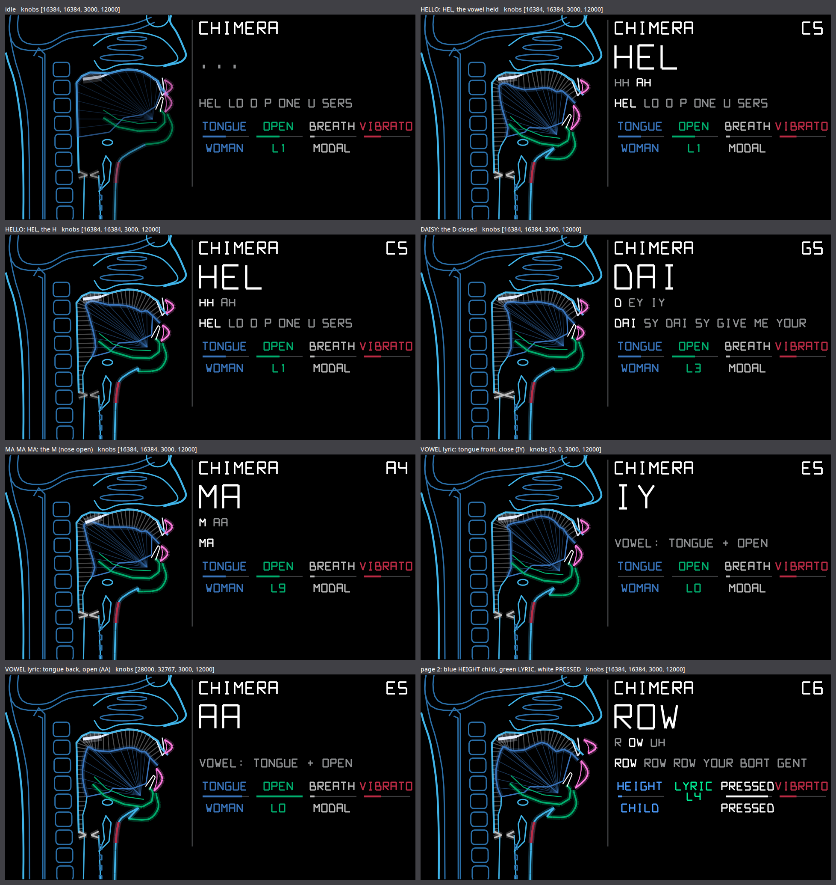

# chimera for op1r

A talking / singing synth plugin for [op1r](https://github.com/Kunstbanause) on the OP-1: a physical-model vocal tract
(Kelly-Lochbaum) with vowel shapes, a lyric that advances with each note, and a head-cutaway screen.

**Needs op1r 43** (the firmware this was built and checked against; older builds may refuse it).
**Not yet tested on real hardware** – expect rough edges.

## Install
Copy `chimera.op1p` to `plugins/` on the OP-1 over USB MIDI, either with the op1r web patcher (Connect OP-1) or
`op1push.py --port <midi device> --files plugins/chimera.op1p`. Confirm on the OP-1 (T1 = restart and apply).
A plugin is program code with full access to the OP-1: only install files from people you trust.

SHA-256: `56b6c9a66b9f32438f8c60f3e8a572bdbe50f3f47deade0c9dfffa5afbf33eaf`

## Credits
Inspired by [chimera-vocal-synth](https://github.com/jamesondh/chimera-vocal-synth) by jamesondh (MIT): the vowel
shapes are fitted to its formant table and the screen's head outline follows its profile drawing.
